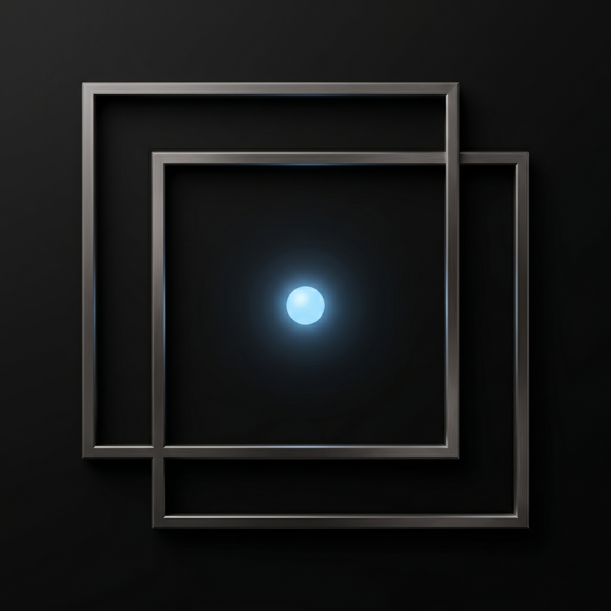

<div align="center">



# DualCam — Dual-Camera Analysis Tool

**Real-time synchronous capture, denoising, alignment and differential analysis for two-camera setups.**

Built with C++17 · Qt 6 · OpenCV 4/5 — runs on Windows 11 desktops and Raspberry Pi 5.

<sub>Developed for the scientific and metrology work of the Institute of Physics, National Academy of Sciences of Ukraine (IF NASU).</sub>

</div>

---

## Table of contents

- [What it does](#what-it-does)
- [Why it exists](#why-it-exists)
- [Screenshots & figures](#screenshots--figures)
- [Feature tour](#feature-tour)
- [How the pipeline works](#how-the-pipeline-works)
- [The interface, panel by panel](#the-interface-panel-by-panel)
- [Channel balance k](#channel-balance-k)
- [Saving data: snapshots and EXIF](#saving-data-snapshots-and-exif)
- [Dependencies](#dependencies)
- [Building from source](#building-from-source)
- [Running on a Raspberry Pi 5](#running-on-a-raspberry-pi-5)
- [Hotkeys & presets](#hotkeys--presets)
- [Project layout](#project-layout)
- [Troubleshooting](#troubleshooting)
- [License & credits](#license--credits)

---

## What it does

DualCam takes two camera feeds, runs them side by side, and gives you the tools to compare them *quantitatively* in real time. You can denoise each stream, measure how sharp each frame is, line the two views up on top of each other (automatically or by hand), and then look at the difference between them as a heat map. When something is worth keeping, one keystroke saves the frames together with a complete record of every setting that produced them.

It was written for lab work where two cameras look at the same scene — for example a reference channel and a measurement channel — and the interesting signal lives in the *difference* between them rather than in either image on its own.

## Why it exists

Most off-the-shelf camera viewers show you a picture. They don't tell you how sharp it is, they don't keep two streams in lock-step, and they certainly don't subtract one from the other while compensating for the fact that the two cameras are never mounted perfectly. DualCam was built to close that gap: a single, responsive desktop application that treats two cameras as one instrument and records enough metadata that a measurement can be reproduced later.

The whole computer-vision workload runs on a dedicated worker thread, so the heavy lifting (denoising, focus scoring, motion detection) never freezes the interface. Frames are scaled to their on-screen size once and blitted by plain raster widgets — on a Raspberry Pi 5 that is far cheaper than routing the window through OpenGL composition, and it keeps the UI fluid at full frame rate.

---

## Screenshots & figures

> 📸 **This is where your own images go.** The application is highly visual, so a few good screenshots make the README far more convincing. Drop the files into [`docs/img/`](docs/img/) using the names below and they will appear automatically. Suggested captures, roughly in order of usefulness:
>
> | File to add | What it should show | Why it helps |
> |---|---|---|
> | `docs/img/hero.png` | The full main window with the side navigation visible and cameras off (clean placeholder views) | The single most important image — a calm, idle UI reads more clearly than a busy live scene; put it right under the title |
> | `docs/img/dual-mode.png` | Both cameras running side by side (the standard dual-view layout) | Shows the core two-camera workflow |
> | `docs/img/diff-mode.png` | Diff mode active, with the Jet heat map in the result view | Demonstrates the headline feature |
> | `docs/img/visualization-settings.png` | The visualization-settings dialog (noise floor, intensity stretch, colormap controls) | Documents how the difference view is tuned |
>
> If you later add **measurement results** (focus-vs-time curves, before/after denoise comparisons, a difference map next to the raw frames), those are exactly the kind of figures that belong in a "Results" or "Example session" section — tell me and I'll add one.

<!--
Once you add the files, uncomment this block:

<div align="center">
  
</div>
-->

---

## Feature tour

### Camera handling

- **Two streams, one instrument.** Cameras can be started and stopped independently or together. The capture backend adapts to the platform: GStreamer with `libcamerasrc` on the Raspberry Pi, and the default OpenCV backends (DirectShow / V4L2) on Windows and Linux.
- **Geometry correction at the source.** The second camera can be flipped horizontally or vertically on the fly, which is usually how you fix a mirror or an upside-down sensor mount before doing anything else.
- **Exposure control.** Gain and shutter can be driven manually, either shared across both cameras or set per-camera, which matters when you need the two channels radiometrically comparable.

### Image processing

- **Focus / sharpness scoring.** Every frame gets a sharpness number computed from the *variance of its Laplacian* — a standard, fast focus metric. Higher means sharper. Both cameras are scored continuously.
- **Temporal denoising.** A running exponential moving average (EMA) over the last *N* frames smooths out sensor noise. The buffer size `N` is adjustable; internally the blend factor is `α = 1/N`, so a larger buffer means heavier smoothing and more lag.
- **Spatial denoising.** An optional bilateral filter cleans up noise while preserving edges, with adjustable strength.
- **Motion detection.** A MOG2 background subtractor flags movement in the scene, with a tunable threshold, so you can tell a static measurement from one where something moved.

### Alignment (registration)

- **Automatic.** With one click the tool detects features in both frames and computes the homography that warps one onto the other. It tries **SIFT + FLANN** matching first and falls back to **ORB + brute-force Hamming** matching, with **RANSAC** rejecting bad correspondences and a sanity check that throws out degenerate transforms. (The UI labels the active-alignment indicator "ECC" for historical reasons.)
- **Manual, 6 degrees of freedom.** When you'd rather do it by eye, the alignment dialog gives you translation (Tx, Ty), scale/zoom, and three rotations (pitch, yaw, roll). The values are composed into a homography and applied live.

### Analysis & visualization

- **Live focus chart.** A Qt Charts plot at the bottom of the window traces the focus score of both cameras over time, with an adjustable history length.
- **Difference mode.** Computes `D = CAM1 − k·CAM2` on the aligned streams and renders `|D|` as a **Jet colormap** heat map with a colour scale in DN. `k` balances the two channels radiometrically (beam-splitter ratio, sensor and gain differences) and is a calibration constant: **Calibrate k** measures it on an unpolarized, evenly lit scene so that the difference becomes zero, and saves it at once (see *Channel balance k* below). A noise floor zeroes small `|D|`; intensity stretch multiplies `|D|` so its largest value fills the scale, and the factor is shown on the image and in the Diff panel. Pixels clipped in both cameras count as `D = 0`, and so do areas without both cameras' data (warp borders).
- **Peak tracking.** Optionally finds and marks the brightest point(s) in the frame — handy for spot/beam tracking.
- **Profile and surface viewers.** Captured frames can be opened in auxiliary viewers: a line-profile plot (intensity along a drawn line) and a 3D surface plot of a region of interest.

### Workflow

- **Lightweight rendering.** Each frame is downscaled once (anti-aliased) to the exact view size and drawn 1:1 by a raster `ImageView`. There is deliberately no `QOpenGLWidget`: it forced GL composition of the whole window on every frame and could leave the main window black after the 3D surface viewer was closed.
- **Resource monitor.** A CPU/temperature pill in the top bar (amber at 70 °C, high load or a frequency cap; red at 80 °C, throttling or under-voltage). Click it for an overlay with per-core load, app / GUI / camera-thread CPU, ARM clock, fan speed, Raspberry Pi throttle flags, RAM and camera / shown / dropped FPS. The STREAMING pill shows the live camera FPS and turns amber when capture falls behind the requested rate.
- **Fully remappable hotkeys** — every action can be bound to a key combination of your choice.
- **Presets** capture the entire processing configuration (pipeline parameters, alignment matrices, hotkeys) and reload it in one click. The channel balance `k` is not part of a preset: it belongs to the rig and stays as calibrated.

---

## How the pipeline works

A frame's journey from sensor to screen, in order:

1. **Capture.** `CameraWorker`, a dedicated `QThread`, pulls frames from two `cv::VideoCapture` sources. Keeping this off the UI thread is what makes the interface stay responsive under load. On the Pi the ISP delivers BGR directly (`libcamerasrc ! video/x-raw,format=BGR ! appsink`); the earlier software `videoconvert` step cost a full core per camera and capped 1456×1088 at about 20 fps.
2. **Format conversion.** Each frame is converted to the chosen working format (native grayscale, OpenCV grayscale, or color).
3. **Temporal denoise.** If the time buffer is larger than 1, the frame is blended into a per-camera EMA accumulator via `cv::accumulateWeighted` with `α = 1/N`.
4. **Focus scoring.** The frame is run through a Laplacian, and the variance of the result (`stddev²`) becomes the focus score. This is cheap enough to do on every frame.
5. **Motion detection.** A `BackgroundSubtractorMOG2` produces a foreground mask on a ≤320 px proxy of the frame (full-resolution MOG2 took ~40 ms per 1456×1088 frame); the proportion of moving pixels against the threshold decides whether motion is flagged.
6. **Hand-off.** The worker emits the two processed frames plus their focus scores and the motion flag back to the main window, which owns all the display and analysis logic. At most one frame pair is in flight: if the GUI is still busy, the newest pair is dropped rather than queued.
7. **Alignment (optional).** If alignment is on, camera 2 is warped onto camera 1 using either the computed homography or the manual 6-DOF adjustment.
8. **Composition.** Depending on the mode, the main window shows the raw views, a fused overlay, or — in diff mode — the Jet-colored `|CAM1 − k·CAM2|`, optionally noise-gated and contrast-stretched. Before subtracting, the sharper channel is blurred if the sharpness ratio `F1 / (k²·F2)` exceeds 1.15 (the `k²` keeps a pure brightness difference from being mistaken for a focus difference). Every step and factor applied is listed in the Diff panel.
9. **Render.** The result is downscaled to the view's size, converted to 32-bit BGRA (the backing store's native layout) and drawn by an `ImageView`.

The automatic-alignment routine deserves a footnote, because it is a three-stage hybrid rather than a single algorithm. It runs on its own throwaway thread so a slow solve never stalls the capture loop.

1. **Global search (features).** Both frames are reduced to CLAHE-equalised gradient-magnitude maps, and features are detected on those: SIFT (FLANN-matched) first, then ORB and AKAZE (brute-force-matched) as fallbacks (AKAZE only with OpenCV 4.x — OpenCV 5 moved it to `opencv_contrib`). Matches pass Lowe's ratio test plus a mutual cross-check, and the homography is estimated with `cv::findHomography(..., RANSAC, ...)`. This stage is what makes the alignment work from *any* starting offset — it has no notion of the two views being nearly coincident.
2. **Sub-pixel refinement (correlation).** The surviving RANSAC inliers are re-located by normalised cross-correlation of small patches on the gradient maps, with a parabolic fit around the correlation peak, and the homography is re-fitted from the corrected points. SIFT localises a keypoint to roughly half a pixel; in diff mode that residual paints bright false edges that read as signal.
3. **ECC polish (direct).** Pyramidal `cv::findTransformECC`, seeded from the feature solution rather than the identity. ECC on its own is a *local* optimiser and would not converge from an arbitrary camera offset, but started inside the correct basin it contributes what features cannot: every pixel votes, so the residual drops to a fraction of a pixel. Optional, via the **ECC polish** checkbox.

Two design points are worth stating explicitly:

- **Everything operates on gradients, not intensities.** The two cameras are a reference and a measurement channel — they are *supposed* to differ photometrically, and a brightness-matching optimiser would happily distort the geometry to explain that difference away. Gradient magnitude keeps the structure common to both views and discards the per-channel response.
- **Every stage can be rejected.** Each refinement is accepted only if the result still passes the geometric sanity check *and* has not drifted far from the solution it was refining (measured as corner displacement). A refinement that wanders is discarded and the previous stage's matrix is kept, so the pipeline degrades to plain SIFT+RANSAC rather than to garbage.

The solved matrix is written to the INI file and restored on the next launch (the **Remember** checkbox), so a session can start already aligned. It is discarded automatically if the frame size changes, since a homography is only valid at the resolution it was solved at.

---

## The interface, panel by panel

**Main viewports.** Two camera views (Cam 1 / Cam 2) show the raw or processed streams; a Result view shows the composed output — overlay, alignment, or difference map.

**Side navigation.** A collapsible rail switches between the functional sections: Capture, Pipeline, Diff, Focus, Snapshot, Presets and Gallery.

**Capture.** Source selection (camera index or GStreamer pipeline), independent Start/Stop, the flip checkboxes, and exposure controls.

**Pipeline.** The denoise controls (time buffer / EMA and bilateral strength), the motion threshold, and the alignment controls — both the "calibrate automatically" button and the entry point to the manual 6-DOF dialog.

**Diff.** Channel balance `k` with **Calibrate k**, clip level, noise-floor threshold, intensity-stretch toggle and peak tracking for the difference view, plus a readout of every transform applied to the intensities (k, noise floor, stretch factor and resulting scale, clipped and no-overlap fractions, sharpness matching).

**Focus.** The large per-camera focus readouts and the real-time focus chart, with an adjustable history window.

**Snapshot.** Naming, the choice of which parameters to fold into the filename, and a recent-captures preview.

**Presets.** Save, load and delete named configuration profiles.

**Floating controls.** Persistent quick-access buttons (stream toggle, snapshot, mode toggle, focus toggle) plus status "pills" showing live FPS and alignment state. **HK's** opens the Actions & Keybinds menu, **?** the help.

---

## Channel balance k

`k` is the weight of CAM2 in `D = CAM1 − k·CAM2`. It equalizes the two channels, so that an unpolarized scene gives `D = 0` and only the polarized laser remains in the difference.

1. Set the exposure you will measure with (MAN on libcamera cameras) and leave it.
2. Point the rig at an unpolarized, evenly lit scene (a white sheet under room light) with the laser off.
3. Press **Calibrate k**. Over the next 20 frames DualCam takes, in every frame, the median of `CAM1 / CAM2` over the overlap, sampled on every second row and column, using pixels that are 24 DN or brighter and below the clip level in both cameras (at least 1000 such pixels per frame). `k` is the median of the 20 per-frame values; σ is their standard deviation, and the pixel spread is half the interquartile range of the ratios relative to `k` (large values mean the scene is not uniform or not unpolarized). The button counts the frames; pressing it again cancels and keeps the old `k`.
4. `k` is written to the settings file at once, with the date, the number of frames, σ, the pixel spread and the exposure. It is restored on the next start, presets do not change it, and the mouse wheel changes it only when the field has focus. The line under the field shows the record; a value typed by hand is marked *Entered by hand*.
5. Switch the laser on and look at the difference: it uses the saved `k`.

Every snapshot carries the same record in its EXIF (`channelBalance`).

---

## Saving data: snapshots and EXIF

A snapshot is never just a picture — it's a picture plus a record of how it was made.

**Image formats.** You can save the two cameras *combined* into one image, *separately* as two files (`_cam1` / `_cam2`, the **Separate files** option in the Snapshot panel), or save the *difference* map. File names carry a one-second timestamp; a second shot within the same second gets a `_2`, `_3`, … suffix rather than overwriting the first.

**Embedded parameter record.** Every snapshot carries, inside its EXIF `ImageDescription` tag, a JSON record of the full state: capture mode and timestamp, an optional user-supplied name, color mode, flip flags, time-buffer size, motion threshold, fusion state, bilateral filter settings, noise floor, intensity-stretch and peak-tracking flags, the channel balance `k` with its calibration record (`channelBalance`: how it was set, when, over how many frames, its frame-to-frame σ, the pixel spread and the exposure at calibration next to the exposure now) and the clip level (for diff snapshots also the display factor, the DN value at the top of the colour scale and the clipped / no-overlap fractions), the solved warp matrix and the manual 6-DOF adjustments, per-camera exposure (gain and shutter, and whether they were actually applied), the live focus scores, the motion-active flag, diff-mode state and the frame count. In short: enough to reproduce the measurement. The record lives in the image file itself, so it cannot be separated from it; the preview window's METADATA panel reads it back, and so do standard tools (`exiftool`, file properties). Non-ASCII text (a Cyrillic snapshot name, say) is stored as JSON `\uXXXX` escapes, since the EXIF text field is ASCII.

**Embedded EXIF.** The EXIF block is written by a small hand-rolled writer (`exif_writer.cpp`): image description (the record above), make/model, software tag, and exposure time and ISO when manual exposure was applied through libcamera.

---

## Dependencies

| Component | Requirement |
|---|---|
| Compiler | C++17 (MSVC 2022, or GCC 10+) |
| Build system | CMake 3.16 or newer |
| Qt 6 | `Core`, `Gui`, `Widgets`, `Charts`, `OpenGL`, `OpenGLWidgets` (and `DataVisualization` for the integrated surface viewer) |
| OpenCV 4.x or 5.x | `core`, `imgproc`, `video` (background segmentation), `videoio`, `features2d`/`calib3d` (alignment) |
| Raspberry Pi only | `libcamera`, `gstreamer1.0` |

> On Windows the bundled `CMakeLists.txt` defaults `Qt6_DIR` and `OpenCV_DIR` to local install paths: `D:/Qt/6.11.1/msvc2022_64` + `D:/opencv/build` for MSVC, `D:/Qt/6.11.1/mingw_64` + `D:/opencv/build_mingw/install` for MinGW. Adjust these to your machine, or pass them on the command line as shown below.

---

## Building from source

### Windows 11 (MSVC + Ninja)

1. Install Qt 6 (via the Qt Maintenance Tool) and OpenCV (prebuilt or self-compiled).
2. Open the **Developer Command Prompt for VS 2022**.
3. Configure and build:

```cmd
mkdir build && cd build
cmake -G "Ninja" ^
  -DQt6_DIR="C:/Qt/6.11.1/msvc2022_64/lib/cmake/Qt6" ^
  -DOpenCV_DIR="C:/opencv/build" ^
  -DCMAKE_BUILD_TYPE=Release ..
cmake --build . --config Release
```

On Windows the build automatically runs `windeployqt` and copies the required OpenCV DLLs (and, with MinGW, the compiler runtime) next to the executable, so the build output is ready to run. A redistributable copy of the deployed application also lives in [`APP/`](APP/) (`DualCam.exe` with all its Qt/OpenCV DLLs).

### Windows 11 (MinGW, no Visual Studio)

The Qt installer ships MinGW (`D:\Qt\Tools\mingw1310_64`), CMake and Ninja. The OpenCV prebuilt is an MSVC build and cannot be linked with MinGW, so OpenCV is built once from `D:\opencv\sources` into `D:\opencv\build_mingw\install` (see [`BUILD_SETUP.md`](BUILD_SETUP.md)). Then:

```cmd
cmake --preset mingw-release
cmake --build out\build\mingw-release
```

### Linux desktop

```bash
mkdir build && cd build
cmake -G "Ninja" -DCMAKE_BUILD_TYPE=Release ..
cmake --build .
```

> **Build targets.** Besides the main `DualCam` executable, the project defines `test_exif` (a tiny EXIF round-trip check, run with `ctest`) and a standalone `DualCamViewer`. With `-DDUALCAM_SEPARATE_VIEWER=ON` the main app opens the profile and 3-D surface viewers in that separate process instead of in-process.

---

## Running on a Raspberry Pi 5

Install the toolchain and Qt/OpenCV from the distribution packages:

```bash
sudo apt update
sudo apt install qt6-base-dev qt6-charts-dev libopencv-dev \
                 cmake ninja-build libgstreamer1.0-dev
```

Then build as above. On the Pi the capture path uses a GStreamer `libcamerasrc` pipeline and expects two `libcamera`-visible cameras; if fewer than two are found the app warns and attempts a fallback.

At startup the app reads the sensor modes from `rpicam-hello --list-cameras` and only offers resolutions the sensors can deliver — the ISP scales down, never up. For the IMX296 global-shutter cameras that means at most 1456×1088 @ 60 fps (offered as the "native" entries); a saved or custom mode above that is shrunk to fit, keeping its aspect ratio.

---

## Hotkeys & presets

Every action in the app — starting cameras, taking a snapshot, toggling diff or focus mode, opening dialogs — is a named command that you can bind to any key combination. Open **Actions & Keybinds** from the **?** button to see and remap them.

Your keybindings, pipeline parameters and calibration matrices are persisted to the OS configuration location (`AppConfigLocation`) automatically, and named **presets** let you keep several complete configurations and switch between them instantly — useful when you routinely run more than one kind of measurement.

---

## Project layout

```
DualCam/
├── main.cpp              # Application entry point
├── mainwindow.h/.cpp     # UI, rendering, analysis, presets, hotkeys,
│                         #   plus the CameraWorker capture/processing thread
├── exif_writer.h/.cpp    # Minimal JPEG EXIF reader/writer
├── resource_monitor.h/.cpp # CPU / temperature / throttling / FPS sampling
├── viewer_*.cpp/.h        # Auxiliary profile / surface viewers (optional target)
├── test_exif.cpp         # EXIF round-trip test target
├── CMakeLists.txt        # Build configuration
├── CMakePresets.json     # CMake preset definitions
├── BUILD_SETUP.md        # Toolchain setup notes (Windows, MinGW / MSVC)
├── resources.qrc         # Qt resources (icons)
├── appicon.rc            # Windows icon resource
└── icon.ico / icon.png   # Application icon
```

The bulk of the application lives in `mainwindow.cpp` — it owns the window, the image views, the charts, the snapshot logic and the `CameraWorker` thread that does the actual capture and per-frame processing.

---

## Troubleshooting

**The app builds but can't find Qt or OpenCV at configure time.** Point `Qt6_DIR` and `OpenCV_DIR` at your own install paths, either by editing `CMakeLists.txt` or by passing `-D...` on the `cmake` command line.

**It runs but a camera view stays blank.** Check the source selection in the Capture panel — on Windows the camera index must match a device DirectShow can see; on the Pi the two cameras must be visible to `libcamera`.

**Automatic alignment fails or looks wrong.** Feature-based registration needs texture to lock onto. On low-contrast or near-identical scenes it can fail the internal sanity check; fall back to the manual 6-DOF dialog and align by eye.

**Low frame rate or a hot Pi.** Open the resource monitor (click the CPU pill). If `camera` FPS is below the requested rate while `CAM` thread CPU is near 100 %, the per-frame processing is the limit — the bilateral filter is the most expensive option. `THROT now: throttled` or a temperature above 80 °C means the SoC is being slowed down: improve cooling. `under-voltage` means the power supply is too weak.

**Manual exposure has no effect.** Gain and shutter are passed to the sensors through the libcamera pipeline, so they apply to the Pi's CSI cameras only. USB / DirectShow / V4L2 cameras (the fallback path, e.g. on Windows) keep their own exposure; the status bar says so when you change it.

**The difference of an unpolarized scene is not zero.** Lock the exposure (MAN, same gain and shutter for both cameras), then press **Calibrate k** on an evenly lit, unpolarized scene. If the line under `k` says *Exposure changed since calibration*, calibrate again. With exposure on AUTO each camera adapts on its own and `k` drifts from frame to frame. Saturated areas are zero by construction once both cameras clip.

**The difference map is all noise.** Raise the noise floor in the Diff panel, and make sure the two streams are actually aligned first — an un-aligned difference is dominated by registration error, not by the signal you care about.

---

## License & credits

Developed for the scientific and research work of the **Institute of Physics, National Academy of Sciences of Ukraine (IF NASU)**.

Built on the shoulders of the [Qt](https://www.qt.io/) and [OpenCV](https://opencv.org/) projects.

> Add a `LICENSE` file (e.g. MIT, or your institution's preferred terms) and reference it here once chosen.
